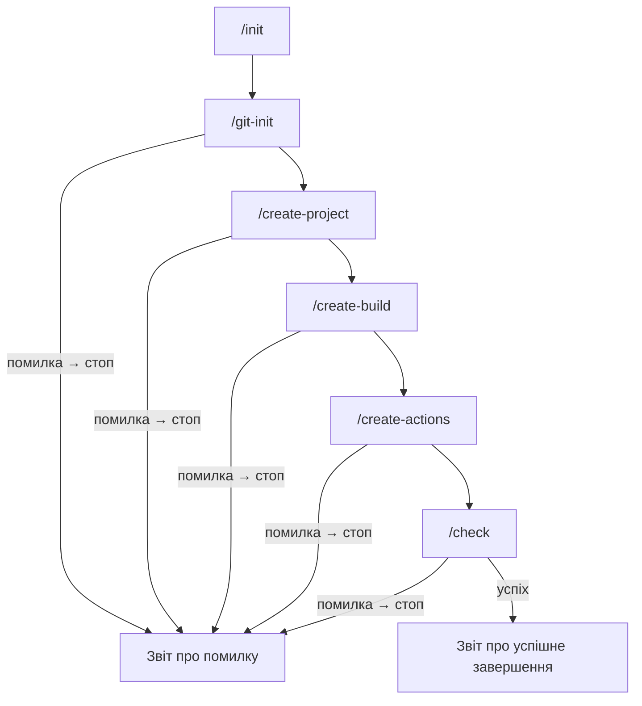

# Архітектура AI-агента build-engineer

## Проблеми, які вирішує агент

Агент автоматизує повторювану підготовку невеликого Rust-проєкту та його CI/CD: створює однакову структуру проєкту, налаштовує Cargo, додає збірку й тести, формує кросплатформні CI-скрипти та GitHub Actions. Послідовний процес зменшує ризик пропустити конфігураційний файл або перевірку й дає зрозумілий результат виконання.

## Структура конфігурації

| Файл | Роль |
|---|---|
| `.github/agents/build-engineer.agent.md` | Manifest custom agent: роль, обмеження, порядок роботи й критерії завершення. |
| `.github/skills/project-scaffold/SKILL.md` | Skill для створення та оновлення структури Rust-проєкту. |
| `.github/skills/build-and-test/SKILL.md` | Skill для локальної збірки, тестів і CI-скриптів. |
| `.github/skills/github-actions/SKILL.md` | Skill для налаштування GitHub Actions. |
| `.github/prompts/git-init.prompt.md` | Команда `/git-init`: підготовка Git-репозиторію та правил ігнорування. |
| `.github/prompts/create-project.prompt.md` | Команда `/create-project`: створення Rust-проєкту. |
| `.github/prompts/create-build.prompt.md` | Команда `/create-build`: налаштування збірки, тестування та локальних CI-скриптів. |
| `.github/prompts/create-actions.prompt.md` | Команда `/create-actions`: створення GitHub Actions workflow. |
| `.github/prompts/check.prompt.md` | Команда `/check`: перевірка згенерованого результату. |
| `.github/prompts/init.prompt.md` | Команда-оркестратор `/init`, що викликає етапи у визначеному порядку. |

VS Code Copilot розпізнає custom agents у `.github/agents/`, agent skills у `.github/skills/<назва>/SKILL.md` і prompt files у `.github/prompts/`. Prompt-файл викликається в чаті як slash-команда `/назва`, де назва відповідає імені файлу без суфікса `.prompt.md`.

## Зв'язок команд і skills

| Команда | Skills | Призначення |
|---|---|---|
| `/git-init` | Немає спеціалізованого skill | Підготувати Git-репозиторій і `.gitignore`, не змінюючи історію. |
| `/create-project` | `project-scaffold` | Створити каркас Cargo-проєкту та Hello World із тестом `BasicAddition`. |
| `/create-build` | `build-and-test` | Налаштувати каталог збірки `build/`, `ci.bat`, `ci.sh`, збірку й тестування. |
| `/create-actions` | `github-actions` | Створити workflow для трьох ОС, що запускає відповідний CI-скрипт. |
| `/check` | `build-and-test`, `github-actions` | Перевірити структуру, збірку, тест, CI-скрипти, workflow та ігнорування артефактів. |
| `/init` | Усі три skills через команди-етапи | Оркеструвати повний процес до успішної перевірки. |

## Дані між етапами

Оркестратор передає між командами спільний контекст:

- `project_name=hello`;
- мова — Rust, система складання — Cargo, тестова команда — `cargo test`;
- назва обов'язкового тесту — `BasicAddition`;
- шляхи створених і змінених файлів, щоб наступні етапи могли перевіряти та оновлювати їх;
- каталог артефактів збірки — `build/`, заданий як Cargo `target-dir`;
- результат кожного кроку та підсумковий результат `/check`.

Очікувані результати включають Cargo-маніфест, вихідний код програми, тест, `.gitignore`, скрипти `ci.bat` і `ci.sh`, а також `.github/workflows/ci.yml`.

## Обробка помилок

Перед початком кожного етапу оркестратор перевіряє його передумови та наявність результатів попереднього етапу. Якщо команда завершується помилкою або перевірка передумови не проходить, оркестратор зупиняється на першому невдалому кроці, не запускає наступні кроки й повідомляє зрозумілою мовою, який крок не пройшов і що саме потрібно виправити. Загальний успіх повідомляється лише після того, як `/check` завершився без помилок.

## Послідовність виконання

